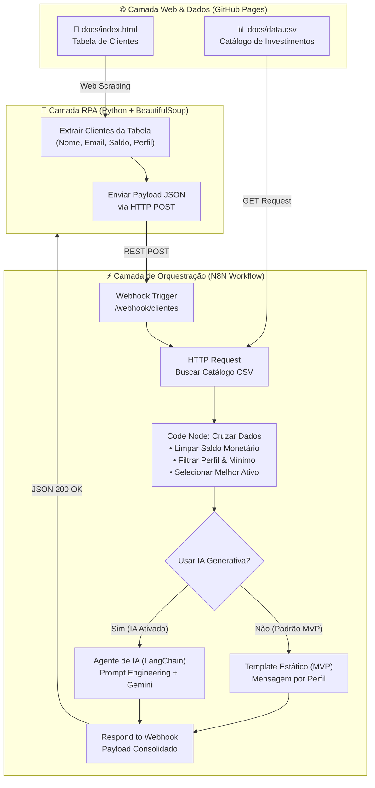

# 🤖 Assistente de Investimentos com RPA e IA Generativa (N8N)

Projeto desenvolvido como solução completa para o desafio final da **[Digital Innovation One (DIO.me)](https://www.dio.me/)**: *"Criando um Assistente de Investimentos com RPA e IA Generativa"*.

---

## 📌 Visão Geral do Projeto

Este projeto demonstra a criação de um ecossistema inteligente de automação financeira ponta a ponta:
1. **RPA (Robotic Process Automation):** Extrai dados cadastrais de clientes (Nome, E-mail, Saldo e Perfil de Risco) de uma aplicação web legada simulada usando Python e BeautifulSoup.
2. **Orquestração Inteligente (N8N):** Recebe os dados via Webhook REST, consome o catálogo oficial de opções de investimento via HTTP (CSV), normaliza valores monetários e cruza os dados com base em perfil de investidor e limite de saldo/aporte mínimo.
3. **Geração de Recomendações:** 
   - **Modo MVP:** Templates consultivos estáticos com lógica condicional avançada.
   - **Modo IA Generativa (Desafio Completo):** Integração com Agente de IA (Google Gemini / OpenAI) para criar recomendações hiperpersonalizadas, acolhedoras e com foco em educação financeira.

---

## 🏛️ Arquitetura da Solução



---

## 📁 Estrutura do Repositório

```text
dio-lab-assistente-investimentos-rpa-n8n/
├── README.md                           # Documentação técnica completa
├── src/
│   ├── extrair_clientes.py            # Script Python executável standalone
│   └── extrair_clientes.ipynb         # Jupyter Notebook (pronto para Google Colab)
├── rpa/
│   ├── extrair_clientes.py            # Cópia compatível com a estrutura original
│   └── extrair_clientes.ipynb         # Notebook original com TODO implementado
├── n8n/
│   ├── workflow.json                  # 🎯 Workflow principal (Unificado: MVP + Roteador IA)
│   ├── workflow_mvp.json              # Workflow MVP puro (sem necessidade de chaves de API)
│   └── workflow_ia.json               # Workflow Desafio Completo (Agente de IA + Gemini)
└── docs/
    ├── index.html                     # Página web simulada com tabela de clientes
    └── data.csv                       # Catálogo de opções de investimento por perfil
```

---

## ⚙️ Decisões Técnicas e Regras de Negócio

### 1. Web Scraping com BeautifulSoup (RPA)
- A função `extrair_clientes()` varre a tabela com seletor `#clientes tbody tr`, extraindo e sanitizando strings de texto.
- O script trata exceções de conexão, exibe feedback visual amigável no terminal e envia os dados formatados em lote para o Webhook do N8N.

### 2. Higienização e Cruzamento de Dados no N8N
- **Tratamento de Moeda:** Converte strings brasileiras (ex: `"R$ 12.500,00"`) para ponto flutuante numérico (`12500.00`).
- **Validação de Capacidade de Investimento:** Um cliente moderado com saldo de R$ 3.200,00 não pode receber indicação de um fundo com aplicação mínima de R$ 5.000,00. O algoritmo filtra: `saldo_cliente >= produto.minimo`.
- **Recomendação Principal:** O algoritmo seleciona a opção mais vantajosa dentro da faixa permitida e lista as demais como opções complementares para diversificação.

### 3. Matriz de Recomendações por Perfil

| Perfil | Foco Estratégico | Opções do Catálogo (`data.csv`) |
| :--- | :--- | :--- |
| **Conservador** | Segurança, Liquidez e Renda Fixa | Poupança (min R$ 100), Tesouro Selic (min R$ 500), CDB Liquidez Diária (min R$ 1000) |
| **Moderado** | Mix equilibrado entre Renda Fixa e Variável | CDB Prefixado (min R$ 1000), Tesouro IPCA+ (min R$ 1000), Fundo Multimercado (min R$ 5000) |
| **Arrojado** | Maior potencial de retorno e tolerância a risco | Criptomoedas (min R$ 100), Ações ETF (min R$ 500), Fundo de Ações (min R$ 10000) |

---

## 🚀 Como Executar o Projeto

### Pré-requisitos
- **Python 3.9+** com as bibliotecas `requests` e `beautifulsoup4`
- **N8N** (instalado localmente via `npm install -g n8n` ou conta gratuita no [N8N Cloud](https://n8n.io/))

---

### Passo 1: Importar o Workflow no N8N
1. Abra o N8N e vá em **Workflows** > **Add Workflow**.
2. Clique nos três pontinhos no canto superior direito (`...`) e selecione **Import from File**.
3. Selecione o arquivo [`n8n/workflow.json`](n8n/workflow.json) (ou `n8n/workflow_mvp.json`).
4. Abra o nó **Webhook - Receber Clientes**:
   - Copie a **Test URL** (para testes imediatos) ou **Production URL** (para produção com workflow ativado).
   - Exemplo local: `http://localhost:5678/webhook-test/clientes` ou `http://localhost:5678/webhook/clientes`.
5. Se for usar a Test URL, clique no botão **Listen for test event** no N8N antes de rodar o Python.

---

### Passo 2: Executar a Extração RPA em Python

#### Opção A: Executando localmente via Terminal
```bash
# 1. Instalar dependências (caso necessário)
pip install requests beautifulsoup4

# 2. Executar passando a URL do seu Webhook N8N como parâmetro:
python src/extrair_clientes.py "http://localhost:5678/webhook/clientes"
```

#### Opção B: Executando no Google Colab
1. Abra o [Google Colab](https://colab.research.google.com/).
2. Faça o upload do notebook [`src/extrair_clientes.ipynb`](src/extrair_clientes.ipynb).
3. Na célula 2, atualize a variável `N8N_WEBHOOK` com a URL do seu Webhook N8N.
4. Execute as células (Menu **Ambiente de Execução** > **Executar tudo**).

---

## 💬 Exemplos de Mensagens Geradas

### Exemplo 1: Perfil Conservador (Ana Silva - Saldo R$ 12.500,00)
> *"Olá, Ana Silva! 🛡️ Identificamos que seu perfil é Conservador e seu saldo disponível é de R$ 12.500,00. Para focar em segurança, liquidez e proteção de capital em renda fixa, recomendamos aplicar em Tesouro Selic com rentabilidade de 13.0% (mínimo de R$ 500). Outras opções seguras acessíveis para você: Poupança, CDB Liquidez Diária."*

### Exemplo 2: Perfil Moderado (Bruno Lima - Saldo R$ 3.200,00)
> *"Olá, Bruno Lima! ⚖️ Seu perfil é Moderado com saldo disponível de R$ 3.200,00. Para construir um mix equilibrado entre segurança de renda fixa e potencial de valorização, indicamos o Tesouro IPCA+ (rentabilidade estimada em IPCA+6.0%). Outras alternativas para diversificar: CDB Prefixado."*

### Exemplo 3: Perfil Arrojado (Carla Souza - Saldo R$ 28.900,00 - via IA Generativa)
> *"Olá, Carla! Analisando seu portfólio, é excelente ver um saldo de R$ 28.900,00 pronto para ser potencializado. Com seu perfil Arrojado, seu foco está em retornos exponenciais a longo prazo, e sua capacidade financeira atual permite alocação direta no nosso Fundo de Ações de alta performance.*
>
> *Além do Fundo de Ações, recomendamos manter uma fatia dinâmica em Ações ETF e Criptomoedas para capturar volatilidades estratégicas do mercado global. Conte com a nossa assessoria especializada para iniciar suas aplicações hoje mesmo!"*

---

## 🏆 Checklist de Entregáveis da DIO

- [x] Repositório estruturado conforme especificação
- [x] Workflow N8N MVP implementado e exportado ([`n8n/workflow.json`](n8n/workflow.json))
- [x] Script de RPA Python integrado ao Webhook do N8N ([`src/extrair_clientes.py`](src/extrair_clientes.py))
- [x] Tratamento de saldos e cruzamento de aporte mínimo com catálogo CSV
- [x] Integração com IA Generativa (Google Gemini / OpenAI via LangChain no N8N)
- [x] Documentação completa com arquitetura Mermaid e guia passo a passo

---

## 👨‍💻 Autor

Desenvolvido por **Leonardo** como parte do bootcamp e desafios de automação da **DIO.me**.
